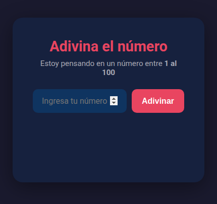
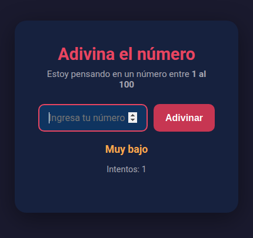
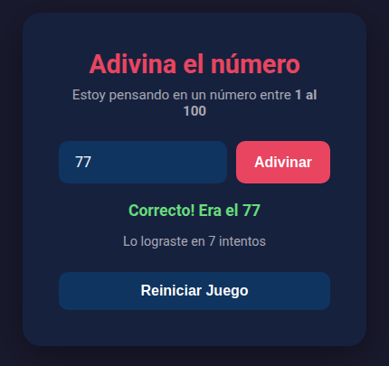

# Adivina el número (Guess My Number)

A small, dependency-free number-guessing game built with vanilla HTML, CSS, and JavaScript. The computer picks a secret number between 1 and 100 and gives "too high" / "too low" hints until you find it, tracking how many attempts it took.

## Features

- Random secret number from 1 to 100 on every game.
- Higher / lower feedback with colour-coded messages.
- Live attempt counter and a win screen showing your score.
- Input validation for empty and out-of-range values.
- Guess with the button or by pressing **Enter**.
- One-click **Reiniciar Juego** (restart) to play again.
- Responsive, self-contained UI with no build step or dependencies.

## Tech stack

- HTML5
- CSS3 (Flexbox, Google Fonts – Roboto)
- Vanilla JavaScript (ES6, no frameworks or libraries)

## Screenshots

| Start | Playing | You win |
| --- | --- | --- |
|  |  |  |

## Getting started

No installation, package manager, or build step is required — it is plain static files.

1. Clone the repository:
   ```bash
   git clone https://github.com/coderblockch/guess-my-number.git
   cd guess-my-number
   ```
2. Open the game in your browser. Either double-click `index.html`, or serve it locally:
   ```bash
   # Option A: open the file directly
   open index.html        # macOS
   xdg-open index.html    # Linux
   # start index.html     # Windows

   # Option B: run a simple local server
   python3 -m http.server 8000
   # then visit http://localhost:8000
   ```

## How to play

1. Type a number between 1 and 100.
2. Press **Adivinar** (or hit **Enter**).
3. Read the hint — *Muy alto* (too high) or *Muy bajo* (too low) — and try again.
4. When you guess correctly, the game shows how many attempts it took.
5. Click **Reiniciar Juego** to start a new round.

## Project structure

```
guess-my-number/
├── index.html   # Markup
├── index.css    # Styles
├── index.js     # Game logic
└── screenshots/ # Images used in this README
```

## License

Released under the [MIT License](LICENSE).
