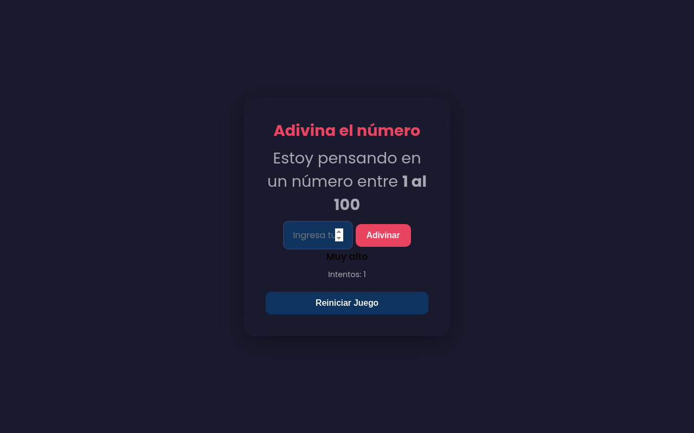

# 🎯 Guess My Number

A small number-guessing game built with vanilla JavaScript. The game picks a random number from 1 to 100 and gives you "too high" / "too low" hints until you find it. The interface is in Spanish ("Adivina el número").

🔗 **[Live Demo](https://coderblockch.github.io/guess-my-number/)**



## Features

- 🎲 Random secret number between 1 and 100 for each game
- ⬆️⬇️ Hints after every guess: **Muy alto** (too high) or **Muy bajo** (too low)
- 🔢 Attempt counter, plus a final message showing how many tries it took
- ✅ Input validation: guesses outside 1–100 or empty input are rejected without counting as a try
- ⌨️ Submit with the **Adivinar** button or the **Enter** key
- 🔄 **Reiniciar Juego** button to start a new game with a new number
- 🔒 Input and button are disabled after you win

## Tech Stack

- HTML5
- CSS3 (Google Fonts)
- Vanilla JavaScript (DOM manipulation, event listeners, game state)

## Run Locally

No build step or dependencies. Open `index.html` in your browser, or serve the folder:

```bash
git clone https://github.com/coderblockch/guess-my-number.git
cd guess-my-number
python3 -m http.server 8000
# then open http://localhost:8000
```

## Project Structure

```
guess-my-number/
├── index.html   # markup
├── index.css    # styles
├── index.js     # game logic
└── docs/
    └── screenshot.png
```

## Author

**David Jimenez**, Sacramento, CA · [GitHub @coderblockch](https://github.com/coderblockch) · [Portfolio](https://portfolio-bay-nine-59.vercel.app)
